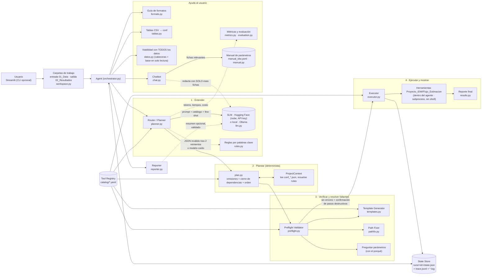
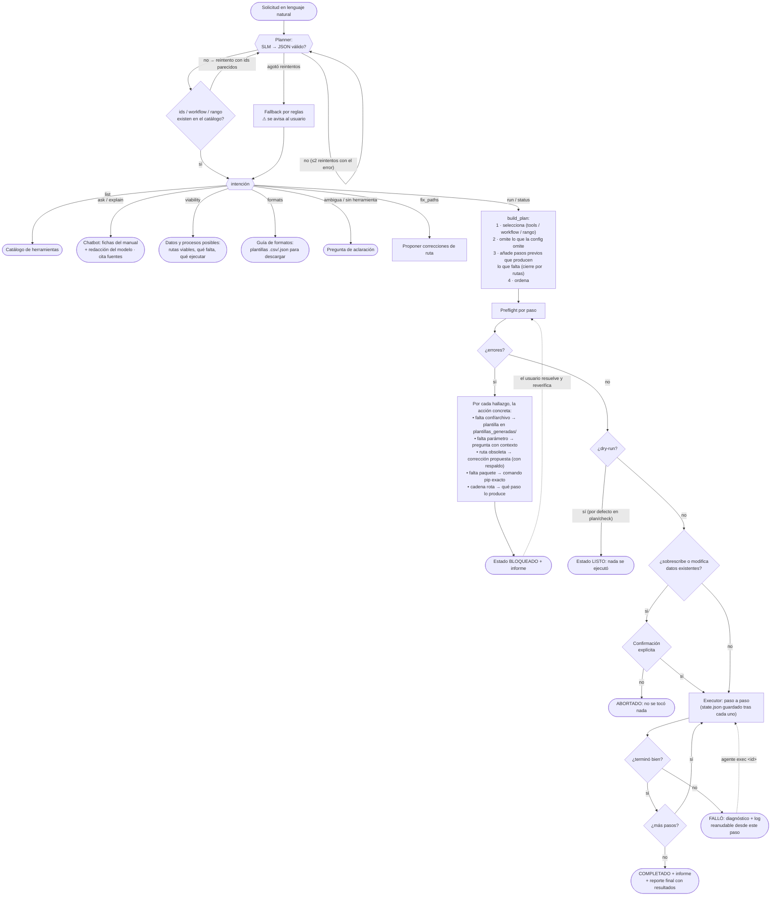

# Arquitectura del Agente de Estimación IDW · v3

> Principio rector: **el SLM solo decide *qué quiere el usuario*; todo lo demás (dependencias, orden, rutas,
> comandos, confirmaciones) lo decide código determinista leyendo el catálogo y tus `conf_*.json`.**
> Un modelo de 4B parámetros acierta mucho en entender una frase y falla bastante en razonar sobre dependencias;
> por eso no se le pide lo segundo.
>
> **v3:** lo mismo vale para las dos funciones nuevas. «¿mis datos alcanzan?» (`datos.py`) se calcula con reglas sobre los archivos
> reales, sin modelo. El chatbot (`chat.py`) no «sabe» estimación: **recupera fichas del manual** y el modelo solo las redacta; si no
> hay fichas relacionadas, no lo consulta.

## 1. Diagrama de componentes



| Componente | Archivo | Responsabilidad | ¿Usa LLM? |
|---|---|---|---|
| Carpetas de trabajo | `workspace.py`, `config.py` | Pide/valida las carpetas de entrada y salida; reubica las rutas de los conf (con respaldo) | No |
| Router/Planner | `planner.py`, `rules.py`, `llm.py` | Solicitud → `PlannerOutput` (JSON estricto, Pydantic); mide tokens, tiempos y costo | Sí (con fallback a reglas) |
| Clientes de modelo | `llm.py` | `CloudClient` (Hugging Face, API compatible con OpenAI: reintentos ante 429/5xx, errores por código HTTP, clave solo en memoria), `OllamaClient`, sondeo de modelos y catálogo público | — |
| Viabilidad | `datos.py` | Reconoce cada archivo por sus cabeceras, abre la base en solo lectura y evalúa rutas y pasos con `data_kinds`/`routes` del catálogo | No |
| Manual | `manual.py`, `catalog/manual_idw.yaml` | 270 fichas (herramientas y cada clave de cada conf); búsqueda léxica; cobertura verificada por prueba | No |
| Chatbot | `chat.py`, `prompts/chat_system.md` | Recupera fichas, redacta con el modelo usando solo ellas, cita fuentes; sin modelo muestra las fichas | Opcional |
| Guía de formatos | `formats.py` | Qué archivo necesita cada herramienta, con plantilla .csv/.json y primeras líneas de tu ejemplo real | No |
| Tablas de parámetros | `tablas.py` | CSV ⇄ clave de un conf (sólidos, topes, pasadas…), con respaldo y verificación | No |
| Reporte final | `results.py` | Lee el Excel del reporte de recursos y lo deja listo para mostrar (solo lectura) | No |
| Métricas / Evaluación | `metrics.py`, `evaluation.py` | Tiempo, tokens, costo comparado; exactitud y seguridad del Router sobre casos de prueba | No (la evaluación llama al SLM) |
| Tool Registry | `catalog.py`, `catalog/*.yaml` | Catálogo declarativo + validación cruzada | No |
| Plan | `plan.py` | Omisiones por config, cierre de dependencias, orden canónico | No |
| Project Context | `context.py`, `jpath.py` | Lee los `conf_*.json`, resuelve rutas y condiciones | No |
| Preflight Validator | `preflight.py`, `schemas.py` | Script, conf, claves, tipos, params, dependencias Python, entradas, salidas, sobrescrituras | No |
| Template Generator | `templates.py` | Conf JSON/YAML y CSV de ejemplo, explicados; nunca sobrescribe | No |
| Path Fixer | `pathfix.py` | Recorre **todas las rutas de todos los conf** y las lleva a las carpetas elegidas (ancla → raíz anterior → nombre único; nunca adivina); edición textual + respaldo + verificación | No |
| Executor | `executor.py` | Subproceso, timeout (mata el árbol), log por paso, diagnóstico de errores | No |
| State Store | `state.py` | JSON atómico por ejecución + traza JSONL → reanudar | No |
| Reporter | `reporter.py` | Informe determinista; el SLM solo añade un resumen validado (opcional) | Opcional |

## 2. Flujo de decisión



### Arbitraje con el léxico del catálogo (lo que enseñó la evaluación)
Medido con gemma3:4b *sin* arbitraje (`eval/resultados_gemma3_4b_crudo.md`): acierta las herramientas individuales (14/14) pero
**no usa workflows ni rangos**, confunde «verifica…» con «ejecuta…» y —lo más grave— ante peticiones fuera de alcance elige una
herramienta «plausible» (`kriging` → `estimar`, `borra la base` → `exportar`). Por eso, tras el SLM, `Planner._arbitrate` aplica
tres reglas deterministas (`llm.arbitrate_with_rules`, activado por defecto):

1. **Intención explícita al inicio de la frase** (`verifica / lista / explica / reanuda / corrige las rutas`) la fija el léxico.
2. **Workflow y rango** (`todo el flujo`, `desde X hasta Y`) los fija el léxico: son frases estructurales de alta precisión.
3. **Anclaje**: toda herramienta elegida por el modelo debe tener al menos una palabra clave del catálogo en la frase; si no, se
   **descarta** y, si no queda nada, se pregunta. El costo es conocido: una paráfrasis sin ninguna palabra clave del catálogo se
   rechaza en lugar de ejecutarse (falla *segura*); se corrige añadiendo la palabra a `keywords`.

Cada corrección queda en el informe («Arbitraje: …») y en `trace.jsonl`.

### Inferencia de dependencias (por qué el modelo no necesita saber el orden)
Cada herramienta declara en el YAML qué **lee** (`inputs`) y qué **crea** (`outputs`), como claves de sus `conf_*.json`.
El agente resuelve esas claves a rutas reales y, si la entrada de A no existe y la salida de B es *exactamente esa ruta*,
B entra al plan antes que A. Ejemplo real de tu proyecto, pidiendo solo `reporte`:

```
reporte ← mb_smeb_categorizado.csv ← categorizar ← mb_smeb_valorizado.csv ← valorizar ← mb_smeb_estimado.csv
        ← estimar ← mb_smeb_recortado.csv ← recortar          (y Database.db ← importar)
reporte ← Plan_Resumen.json (porque conf_reporte.ganancia.activo = true) ← plan
```
Si una cadena está rota (p. ej. `conf_estimacion.modelo` no apunta a la salida de `recortar`), el preflight lo dice y
sugiere qué ruta produce cada paso.

## 3. Estructura de carpetas

```
Proyecto_Agente_v3/
├── README.md                     guía de uso rápido
├── requirements.txt
├── run_ui.bat · run_agente.bat   lanzadores (python_local.txt, .venv, AGENTE_PYTHON o el PATH)
├── .streamlit/config.toml        tema (azul marino + naranja, como los notebooks de la clase)
├── config/
│   └── agent.yaml                herramientas (idw_root), venv, modelos SLM disponibles, seguridad
├── Proyecto_IDW/                 las herramientas, DENTRO del agente
│   ├── Flujo_Estimacion/         scripts del flujo (importar … reporte)
│   ├── Configuraciones/          conf_*.json (+ _respaldo_agente/)
│   └── 01_Data · 02_Resultados   datos/resultados de ejemplo (puedes elegir otras carpetas al abrir la interfaz)
├── catalog/
│   ├── tools_idw.yaml            catálogo REAL: 12 pasos + esquema_bloques · resumen/sinónimos/ejemplos por herramienta ·
│   │                             plantillas de datos · tablas de parámetros · tipos de dato y rutas (viabilidad)
│   ├── manual_idw.yaml           manual de parámetros (270 fichas) · fuente del chatbot y de docs/MANUAL_PARAMETROS.md
│   └── tools_demo.yaml           demo ficticia (3 herramientas)
├── prompts/
│   ├── planner_system.md         prompt del Router/Planner (JSON estricto)
│   ├── chat_system.md            prompt del chatbot (solo con las fichas recibidas)
│   └── reporter_system.md        prompt del Reporter
├── agente/
│   ├── models.py                 Pydantic: catálogo, PlannerOutput, estado
│   ├── config.py                 agent.yaml → AgentConfig
│   ├── catalog.py                Tool Registry + validación + function schemas
│   ├── context.py · jpath.py     lectura de conf_*.json, resolución de rutas/condiciones
│   ├── llm.py                    Hugging Face (nube) · Ollama (local) · Mock · tokens, tiempos y costo
│   ├── planner.py · rules.py     Router/Planner · fallback por palabras clave
│   ├── plan.py                   omisiones + cierre de dependencias + orden
│   ├── preflight.py · schemas.py Preflight Validator · Pydantic dinámico desde el YAML
│   ├── templates.py              Template Generator
│   ├── pathfix.py                reubicación de TODAS las rutas de TODOS los conf
│   ├── executor.py               subproceso + timeout + diagnóstico
│   ├── state.py                  State Store + traza JSONL
│   ├── reporter.py               informe
│   ├── workspace.py              carpetas de entrada/salida
│   ├── formats.py · tablas.py    guía de formatos · tablas CSV ⇄ conf
│   ├── results.py                lector del reporte final
│   ├── datos.py                  viabilidad con todos los datos
│   ├── manual.py · chat.py       manual de parámetros · chatbot
│   ├── metrics.py · evaluation.py  métricas del proceso · evaluación del Router
│   ├── orchestrator.py           Agent: une todo
│   ├── ui_streamlit.py · ui_theme.py  interfaz web (principal) · tarjetas y estilo
│   ├── cli.py                    CLI/REPL (opcional)
├── examples/demo_project/        proyecto ficticio de la demo (scripts + confs)
├── eval/                         casos de evaluación (desarrollo, reservado v2 y reservado v3) + runner de métricas
├── tests/                        pytest (unidades, inyección de fallos, ciclo completo, UI, tablas, formatos, viabilidad, chat, nube…)
│   └── fixtures/confs_mixtos/    conf con rutas de dos proyectos distintos: caso real que motivó la reubicación completa
├── docs/                         este documento, manual de parámetros, recomendaciones, evaluación
├── runs/                         (generado) estado, traza y logs por ejecución
└── plantillas_generadas/         (generado) plantillas que el agente crea cuando falta algo
```

## 4. Elección del framework (propia ligera, y por qué)

| Opción | A favor | En contra para este caso |
|---|---|---|
| **Implementación propia (elegida)** | Control total del flujo; un solo lugar donde ocurre cada decisión; sin dependencias nuevas; el fallback por reglas, la reanudación y la confirmación de pasos destructivos son 20 líneas, no un plugin | Hay que escribir la máquina de estados (ya está) |
| LangGraph | Grafos con checkpoints, útil para agentes con muchos ciclos | El flujo aquí es lineal y determinista; el grafo sería ceremonial. Añade el stack LangChain al venv donde conviven torch/trimesh |
| smolagents | Rápido para "agentes que escriben código" | **Contradice tus restricciones**: el modelo ejecutaría código/comandos que él genera. Aquí el modelo nunca ejecuta nada |
| LlamaIndex Workflows | Buenos eventos/pasos | Sobredimensionado: no hay RAG; mismas dependencias pesadas |

Un SLM de 4B es poco fiable en bucles ReAct largos (olvida el formato, repite herramientas). Con *"una sola llamada → JSON → código determinista"* la superficie de error es mínima y medible.

## 5. Modelo de seguridad

| Riesgo | Control |
|---|---|
| Comando arbitrario | Solo se ejecutan `python -X utf8 <script del catálogo> <args del catálogo>`; sin shell; los placeholders solo admiten `{config}`, `{root}`, `{config_dir}`, `{param.X}` |
| Parámetro malicioso (ruta fuera de tus carpetas) | Los parámetros tipo `path` deben caer dentro de la carpeta de entrada, la de salida o `Configuraciones` (o `safety.extra_allowed_roots`); se valida con Pydantic |
| Sobrescribir resultados | `destructive: true` + salida existente ⇒ confirmación explícita (`--yes` la concede conscientemente); respaldo opcional `.bak_<fecha>` |
| Editar tus conf | Rutas (al elegir carpetas: todas, de todos los conf), el valor `origen` al usar una ruta del análisis de datos o el botón «Usar origen…» de la verificación previa (hallazgo `ORIGIN_ALTERNATIVE`: cuando el conf pide collar/survey/assay pero la carpeta solo tiene compósitos, o al revés; el origen inválido como «tablas» se marca `CFG_ORIGIN_INVALID`), tablas CSV y valores simples **solo por una acción tuya** en la interfaz; respaldo previo en `Configuraciones/_respaldo_agente/<fecha>/`, JSON validado antes de escribir; las rutas se editan de forma **textual** (formato intacto). Las pruebas verifican que no tocan tus conf reales |
| Plantillas pisando datos reales | Se escriben fuera del proyecto; `promote` nunca sobrescribe; los datos de ejemplo son un `--kind all` explícito |
| Datos a un servicio externo | Con la nube (Hugging Face) salen **solo la frase, el catálogo y las fichas del manual de tu duda**; nunca archivos de datos ni rutas (una prueba lo verifica). Con Ollama no sale nada. La interfaz lo indica |
| Filtración de la API key | Vive en un campo de contraseña o en `HF_TOKEN`; es un `SecretStr` excluido de la serialización; no se escribe en disco, estado, trazas ni mensajes de error (pruebas lo verifican). La CLI no la acepta como argumento |
| Alucinación del chatbot | Responde solo con fichas recuperadas del manual y las cita; sin fichas no consulta al modelo; si el modelo falla, muestra las fichas |
| Fallos silenciosos | Cada paso: código de retorno, log completo, diagnóstico traducido, traza JSONL; el flujo se detiene en el primer error |

## 6. Cómo agregar una herramienta (sin tocar el código del agente)

1. Copia el script a `Proyecto_IDW/...` (cualquier `.py` que reciba sus argumentos por CLI).
2. Añade una entrada a `catalog/tools_idw.yaml`:

```yaml
  - id: mi_herramienta                  # minúsculas y _
    title: Mi herramienta
    description: Qué hace, en una frase (es lo que lee el SLM).
    summary: Explicación llana de 2-3 frases (se muestra al usuario).
    order: 13                           # posición en el flujo (category: utilidad = fuera del flujo)
    keywords: ["mi herram*", "palabra clave"]     # para el fallback por reglas; * = resto de la palabra
    synonyms: ["otra forma de pedirlo", "jerga"]  # suman al léxico (no van al prompt)
    examples: ["ejecuta mi herramienta", ...]     # ≥5; el 1.º alimenta el few-shot y TODOS son una prueba ejecutable
    data:                                         # viabilidad: qué datos necesita y qué deja disponible
      alternatives: [{needs: [mi_dato], gives: [mi_resultado]}]
    runner: {script: Flujo_Estimacion/MiHerramienta.py, args: ["{config}"], timeout_s: 600}
    config: conf_mia.json
    required_keys: [entrada, salida]
    requires_python: [{module: scipy}]
    inputs:  [{name: datos, key: entrada, template: mi_csv}]   # si falta, genera un CSV de ejemplo
    outputs: [{name: resultado, key: salida}]                  # permite inferir quién la precede
    destructive: true
    destructive_reason: Sobrescribe el resultado anterior.
    config_template:                    # genera/valida conf_mia.json
      module: MiHerramienta
      fields:
        - {name: entrada, type: path, default: "{root}/01_Data/x.csv", description: CSV de entrada}
        - {name: salida,  type: path, default: "{root}/02_Resultados/y.csv", description: Resultado}
```
3. Añade sus claves al manual (`catalog/manual_idw.yaml`): la prueba de cobertura falla si un conf trae una clave sin ficha.
4. `python -m agente doctor` valida el catálogo (campos desconocidos, plantillas inexistentes, ids repetidos fallan al cargar);
   `pytest tests/test_v3_catalog.py` exige que cada ejemplo lleve a su herramienta.
